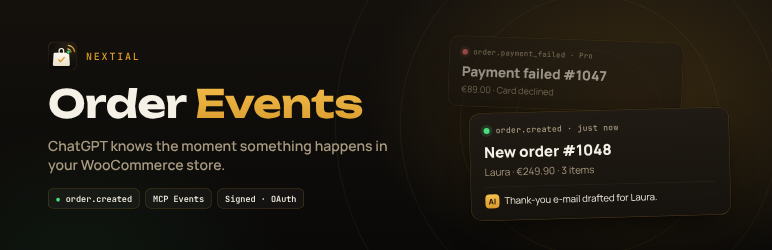
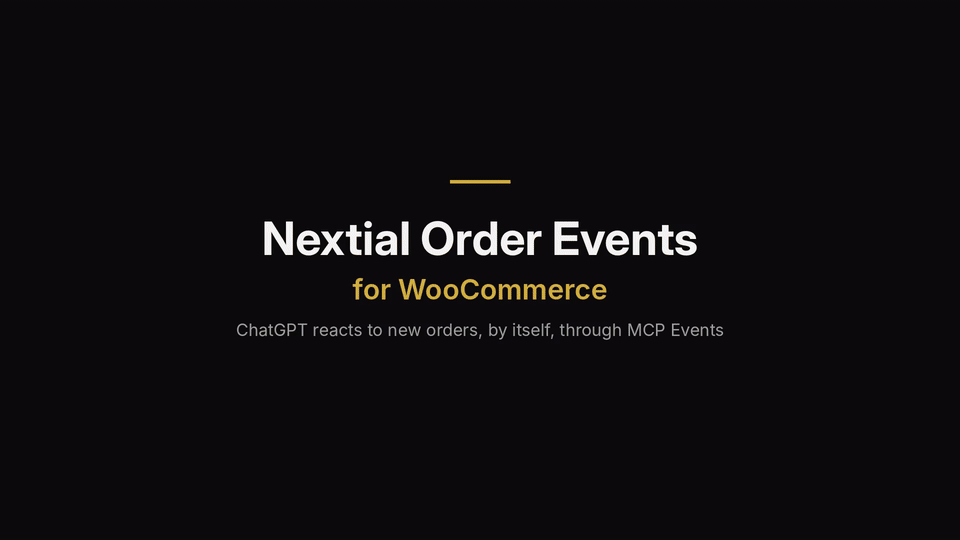

# Nextial Order Events for WooCommerce

**ChatGPT gets a new order alert the moment a WooCommerce order arrives, and acts on it by itself.**

A WordPress plugin that turns a WooCommerce store into an MCP server with **MCP Events**: instead of waiting to be asked, the store pushes a signed notification to ChatGPT (or any compatible MCP client) when something happens.

- Watch the 20-second demo on YouTube: https://youtu.be/3HoLkg69c0o
- Install from WordPress.org: https://wordpress.org/plugins/nextial-order-events-for-woocommerce/
- Pro add-on (more events): https://nextial.it/order-events/

## What you can ask ChatGPT

- "Tell me here whenever a new order arrives, with the total and the products."
- "When an order over $200 comes in, draft a personal thank-you e-mail for the customer."
- "Every evening, sum up today's orders for me."

ChatGPT subscribes to the event, the store notifies it when it happens, and ChatGPT does the rest. No Zapier, no polling.

## How it works

| Piece | Implementation |
| --- | --- |
| MCP server | Endpoint `https://YOUR-SITE/wp-json/nextial-order-events/v1/mcp`, protocol `2026-07-28` (compatible with 2025 revisions) |
| Events | `events/list`, `events/subscribe`, `events/unsubscribe`; free event: `order.created` |
| Delivery | Webhooks signed with [Standard Webhooks](https://www.standardwebhooks.com/) (HMAC-SHA256), callback verified with a challenge, retries with backoff via Action Scheduler |
| Auth | OAuth 2.1 with PKCE, Client ID Metadata Documents, Dynamic Client Registration, RFC 9207; or a secret URL |
| Tools | Read-only: `get_order`, `list_recent_orders`, `list_low_stock_products` |
| Privacy | Notifications carry no customer e-mail, phone or address; only public HTTPS callbacks, no redirects |

The settings page (WooCommerce → Nextial Order Events) includes a full self-test (subscribe → verify → signed delivery → unsubscribe), a live listener for real store events, an OAuth check and a delivery log.

## Quick start

1. Install and activate the plugin, open **WooCommerce → Nextial Order Events** and copy the connection URL.
2. In ChatGPT: **Plugins → Add → Add custom MCP server**, paste the URL, choose **OAuth**.
3. Sign in on your site and press **Allow**.
4. In a **Work** chat, type `@`, pick your store and ask: "Tell me here whenever a new order arrives."
5. Place a test order: ChatGPT writes in the chat a few seconds later.

## Requirements and limits

- WooCommerce, PHP 7.4+, WordPress 6.5+, HTTPS.
- A paid ChatGPT plan with Work chats (Plus or higher at the time of writing). On the free plan only the read-only tools work.
- ChatGPT "dots" are not available in the EU, Switzerland and the UK yet; Work chats work there (tested from Italy).

## Extending

Add-ons can register their own events with the filters `nextial_oe_event_definitions`, `nextial_oe_event_matches`, `nextial_oe_event_payload`, `nextial_oe_sample_payload` and queue deliveries with `Nextial_OE_Events::enqueue()`.

## Support

Use the [WordPress.org support forum](https://wordpress.org/support/plugin/nextial-order-events-for-woocommerce/) or open an issue here. The released version lives on WordPress.org; this repository mirrors it.

## License

GPLv2 or later. WooCommerce is a trademark of Automattic Inc. ChatGPT is a trademark of OpenAI. This is an independent plugin by [nextial](https://nextial.it) and is not affiliated with Automattic or OpenAI.
